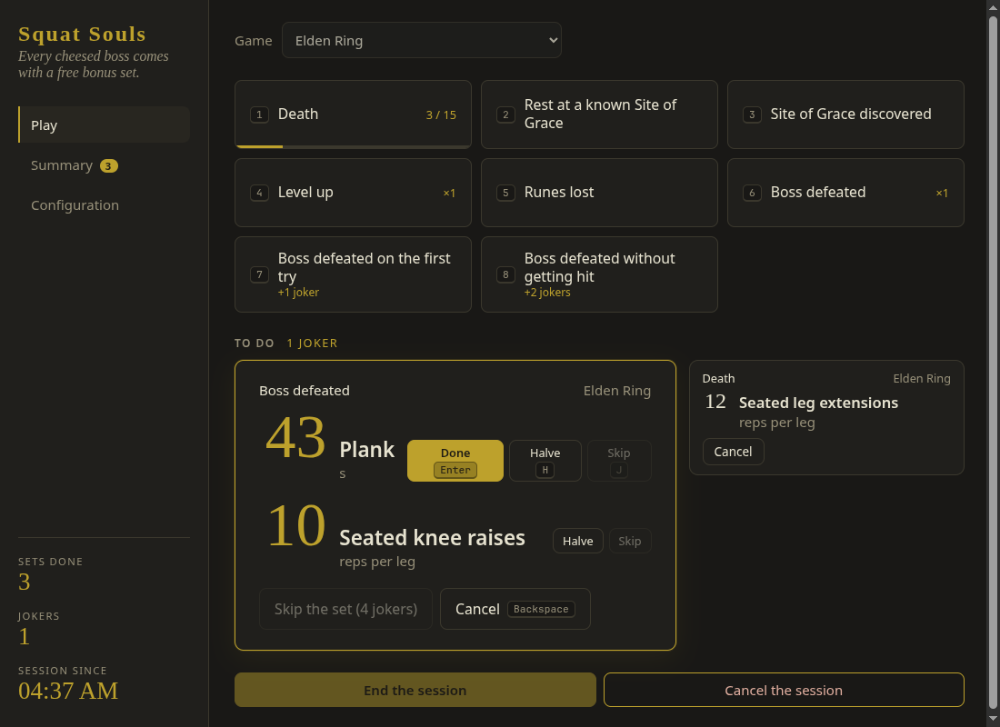
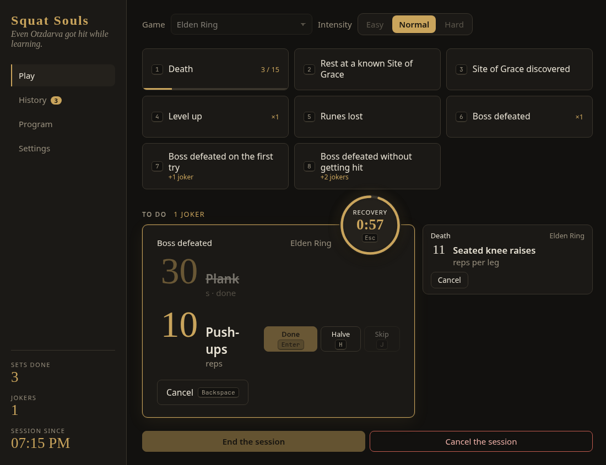
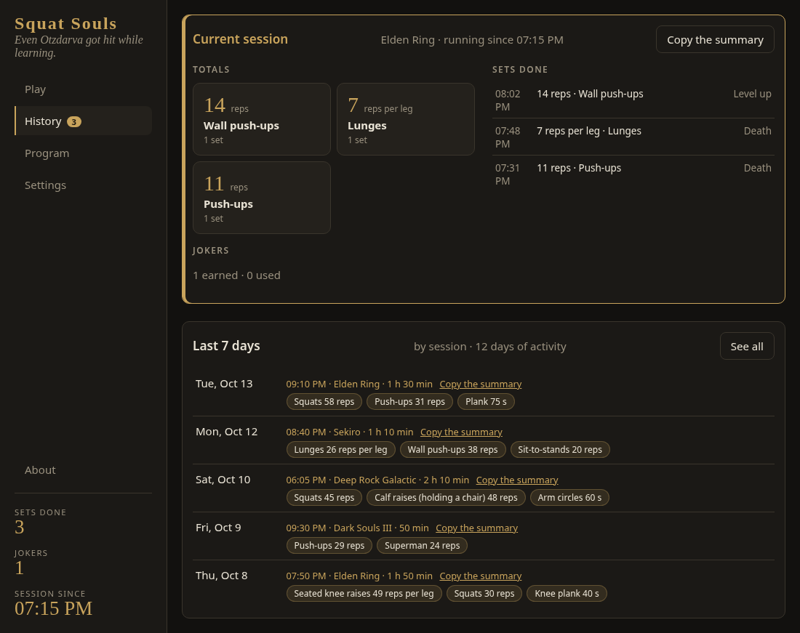
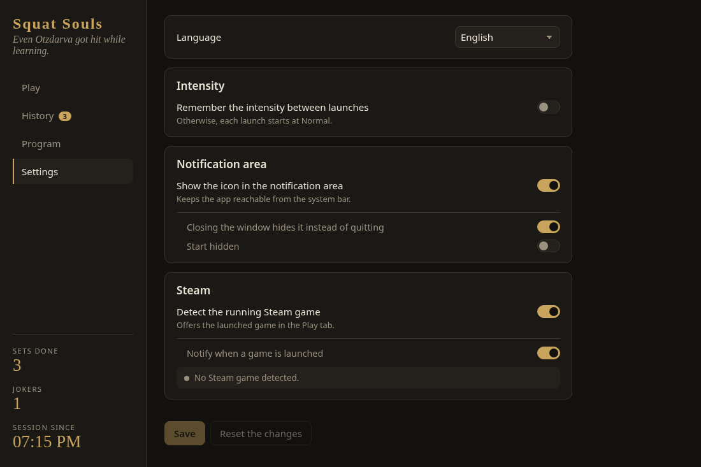
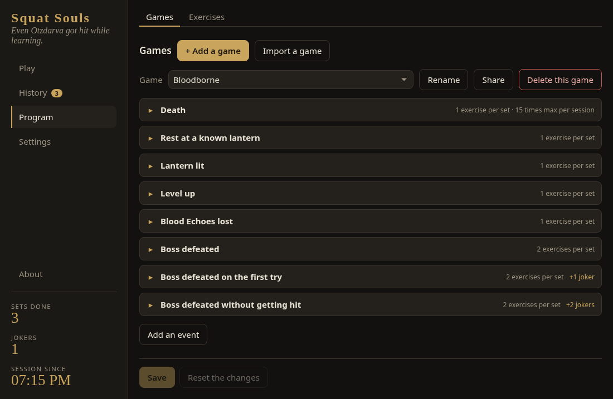
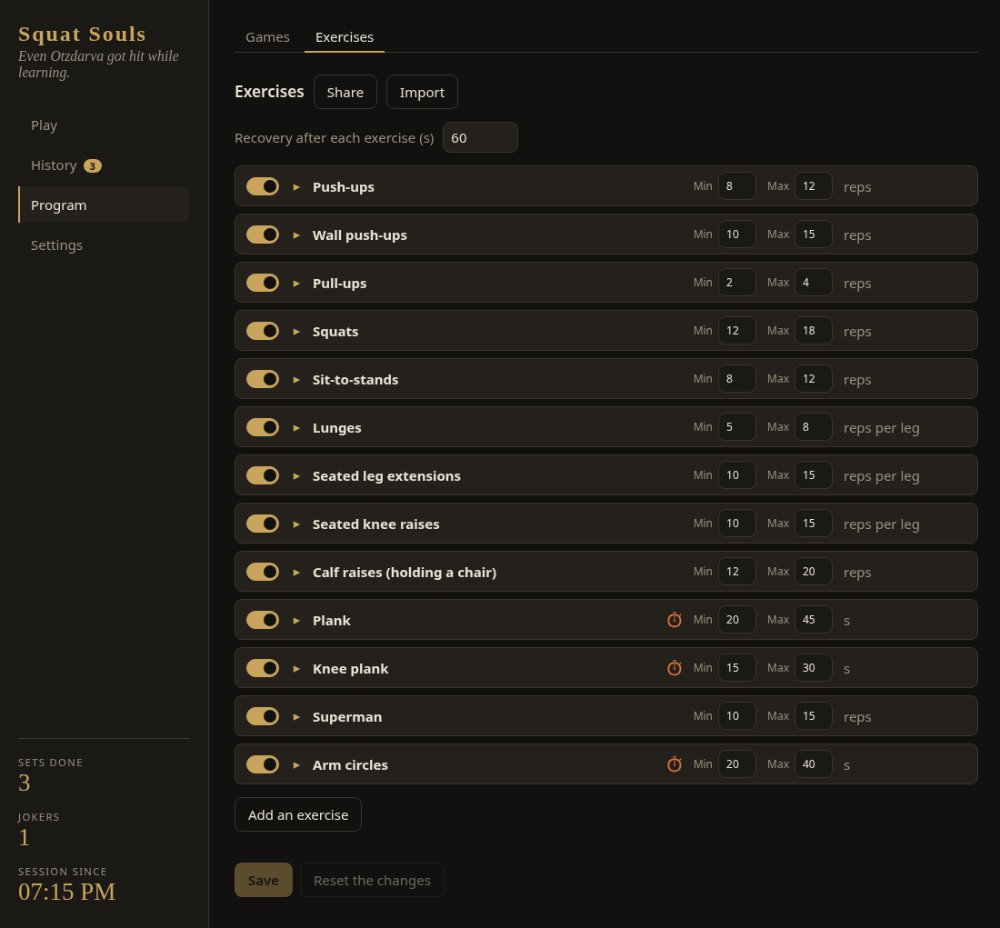

# Squat Souls

Turn what happens in your games into bodyweight exercises.


[](LICENSE)
[](https://github.com/Semche95/SquatSouls/actions/workflows/build.yml)



| Recovery | History | Settings |
| --- | --- | --- |
|  |  |  |

| Program: games | Program: exercises |
| --- | --- |
|  |  |

## What is it

A small desktop app you keep open next to your game. When something happens in game (you die, beat a boss), you click that event and the app gives you a few bodyweight exercises with a random number of reps. Do them before you carry on playing.

You configure your own games, events and exercises. The defaults are only a starting point.

## Features

- Exercises come out in rounds, so each one comes out before any comes back.
- Per-session limit on each event, and jokers to halve or skip an exercise.
- Intensity of the session (Easy, Normal, Hard) to scale the numbers on tired days, without touching the configuration.
- Recovery countdown between exercises, and a timer for exercises counted in time.
- Summary of the session and of the last 7 days, plus the full history, each session copyable to paste in a messaging app.
- Keyboard shortcuts, Steam game detection, notification area icon.
- Share games and exercises with other players.
- Interface in English and French.

## Install

| OS | Packages | Status |
| --- | --- | --- |
| Windows | `.msi`, `.exe` | Tested |
| macOS | | Coming later |
| Linux | `.deb`, `.rpm`, `.AppImage` | Developed and used on Arch Linux |

No release is published yet. Packages are artifacts of the [Build workflow](https://github.com/Semche95/SquatSouls/actions/workflows/build.yml): open a successful run and download `squat-souls-windows` or `squat-souls-linux` (GitHub sign-in required).

### Build from source

Install Rust (stable), Node.js (LTS), pnpm and the [Tauri 2 prerequisites](https://v2.tauri.app/start/prerequisites/) of your system. On Arch Linux:

```bash
sudo pacman -S --needed webkit2gtk-4.1 base-devel curl wget file openssl appmenu-gtk-module libappindicator-gtk3 librsvg rustup nodejs pnpm
rustup default stable
```

Then:

```bash
git clone https://github.com/Semche95/SquatSouls.git
cd SquatSouls
pnpm install
pnpm tauri build   # packages in src-tauri/target/release/bundle/
```

## Usage

1. In **Play**, choose your game, then click **Start the session** when you start playing.
2. You die in game: click **Death**, or press 1. A set appears in **To do**, for example 14 squats.
3. Do them, then click **Done** or press Enter. A recovery starts.
4. When you stop playing, click **End the session**. It shows up in **History**.

| Key | Action |
| --- | --- |
| 1 to 9 | Trigger the event with that number |
| Enter | Mark the next exercise done |
| H | Halve it (1 joker) |
| J | Skip it |
| T | Start its timer, if it is timed |
| Space | Hold or resume the timer |
| Backspace | Cancel the set |
| Escape | Skip the recovery or stop the timer |

Games, events and exercises are edited in **Program**, the options in **Settings**. The full rules are in [docs/BEHAVIOR.md](docs/BEHAVIOR.md). Where the database and logs are stored: [docs/DATA-AND-LOGS.md](docs/DATA-AND-LOGS.md).

## Linux notes

The app forces `GDK_BACKEND=x11` and `WEBKIT_DISABLE_DMABUF_RENDERER=1`, because WebKitGTK is unstable under Wayland. Set them yourself to override, for example `GDK_BACKEND=wayland squat-souls`.

## Development

```bash
pnpm tauri dev             # run in development
cd src-tauri && cargo test # backend tests
pnpm test                  # interface tests
```

Project layout, translations and rules: [CONTRIBUTING.md](CONTRIBUTING.md).

## License

[MIT](LICENSE)
